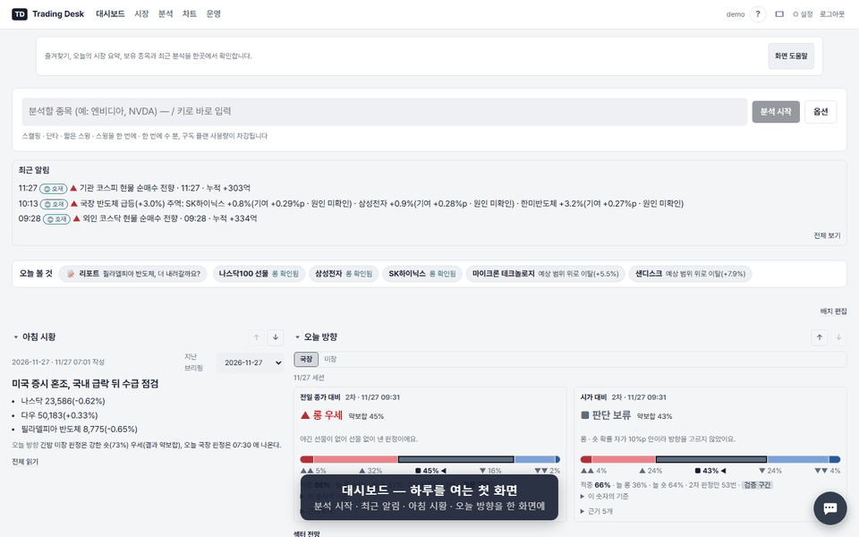
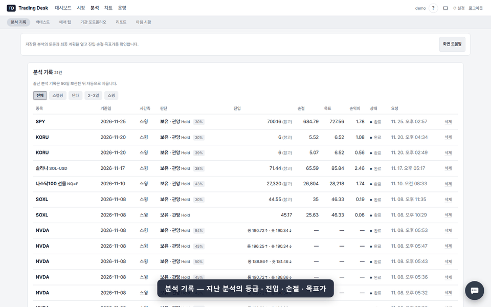
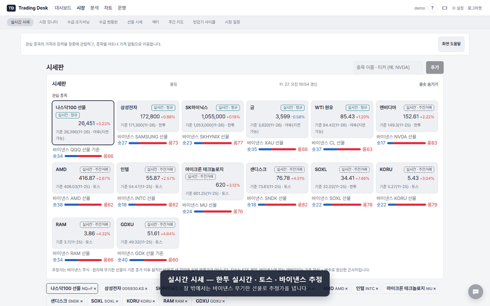
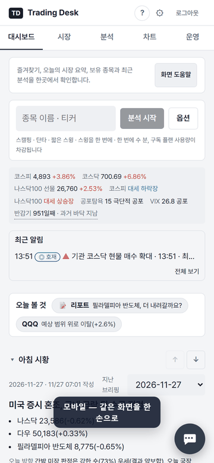
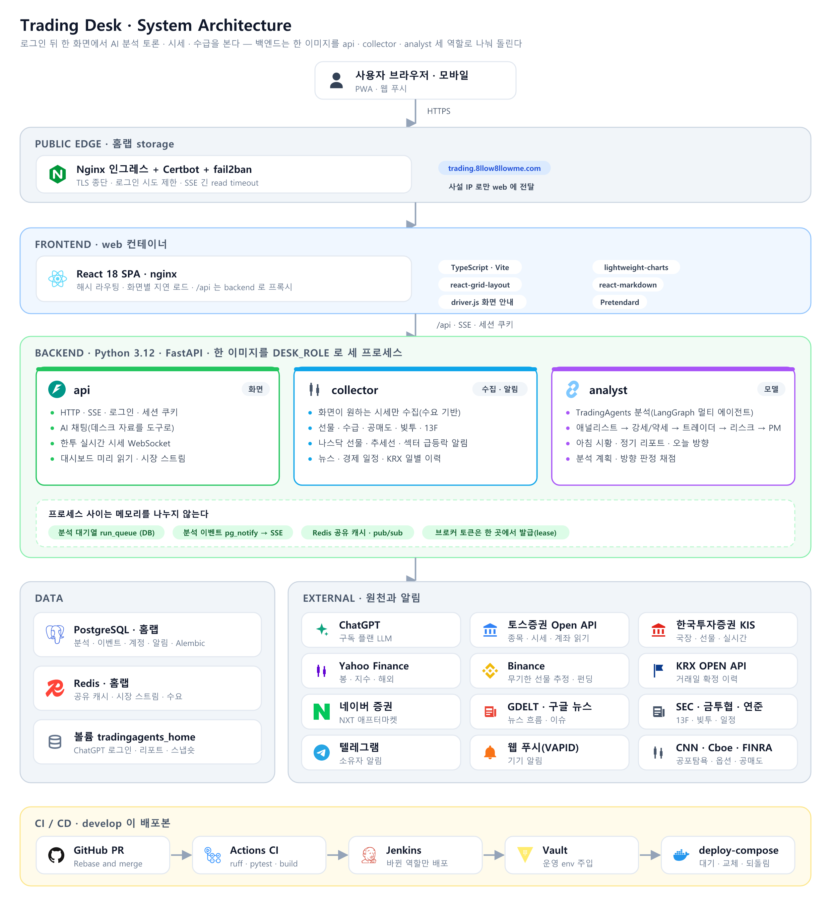

# Trading Desk

> [TradingAgents](https://github.com/TauricResearch/TradingAgents) 의 멀티 에이전트 토론을 **채팅처럼 실시간으로 보고**,
> 결과(등급 · 진입가 · 손절가 · 목표가)를 **대시보드에 쌓는** 1인용 트레이딩 데스크.
>
> 종목 하나를 넣으면 애널리스트 → 강세 / 약세 토론 → 트레이더 → 리스크 토론 → PM 이 차례로 말하고, 끝나면 **스캘핑 · 단타 · 짧은 스윙 · 스윙 네 기간의 계획**이 남습니다.
> 그 옆에서 실시간 시세 · 선물 · 수급 · 섹터 · 알림이 "지금 시장이 그 계획에 동의하는지"를 보여 줍니다.

| 항목 | 내용 |
| --- | --- |
| 프로젝트명 | Trading Desk (trading-desk) |
| 한 줄 소개 | LLM 멀티 에이전트 분석 토론 + 시장 · 수급 대시보드 |
| 형태 | 1인 개발 · 1인 사용(계정은 CLI 로만 만든다) · 홈랩 운영 |
| 개발 기간 | 2026.11 ~ 진행 중 (커밋 960+ · PR 600+) |
| 운영 | `https://trading.8llow8llowme.com` (로그인 필요) |
| 주문 | **일부러 없음** — 브로커 포트에 주문 메서드가 없다. 붙이기 전 조건은 [아래](#실행주문--아직-없음-붙이기-전-조건) |

## 설계 포인트

- **TradingAgents 를 라이브러리로**: 포크하지 않고 커밋 SHA 로 고정해 의존한다. `stream_run()` 의 상태를 이전과 비교해 **새 필드 = 그 에이전트의 발언**으로 바꾸므로(`events.StateDiffer`) LangGraph 노드 이름이 바뀌어도 덜 깨진다.
- **SSE 는 DB 에서 재생**: 이벤트 테이블이 정본이고 `Last-Event-ID`(= `seq`)부터 다시 읽는다. 새로고침 · 재접속해도 토론이 그대로 남는다. 프로세스 사이는 PostgreSQL `pg_notify` 로 알린다.
- **한 이미지, 세 역할**: 백엔드 하나를 `DESK_ROLE=api | collector | analyst` 로 나눠 돌린다. 화면(HTTP · SSE)은 모델 실행 · 수집에 막히지 않고, 역할별로 따로 배포한다.
- **수요 기반 수집 + 공유 캐시**: 화면이 지금 읽는 종목만 collector 가 원천(토스 · 한투)에서 모아 Redis 로 나눈다. 화면을 닫으면 그 수집도 멈춘다 — 원천 호출 한도 안에서 빠르게.
- **계획은 구조화 출력에서**: TradingAgents 가 고정 영어 라벨(`**Entry Price**: 182.5`)로 렌더링한 결과를 읽고, 모델이 비운 가격은 ATR(14)로 채우며 출처를 표시한다.
- **계좌는 소유자만**: 모든 경로가 로그인(세션 쿠키 · CSRF · 시도 제한) 뒤에 있고, 브로커 계좌 데이터와 계좌를 읽은 분석은 첫 계정만 본다([docs/security.md](docs/security.md)).
- **배포는 develop 머지 뒤 자동**: Jenkins 가 CI 성공을 기다려 바뀐 역할만 올리고, 진행 중 분석을 기다렸다가 교체 · 확인하며 실패하면 직전 이미지로 되돌린다. 운영 env 는 Vault 에서 받는다.

## 주요 기능

> 모든 기능을 흐름 순서대로 GIF 로 보여 주는 소개는 **[docs/FEATURES.md](docs/FEATURES.md)** 에 있습니다. 운영 서버를 Playwright 로 직접 조작해 녹화했습니다(2026-11-27, 소유자가 아닌 녹화용 계정 — 계좌 정보 없음).

### 사용 흐름

```text
로그인 → 대시보드(알림 · 아침 시황 · 오늘 방향) → 종목 입력 · 분석 시작 → 토론을 채팅으로 지켜보기 → 네 기간 계획 · 차트 · 근거
      └→ 실시간 시세 · 선물 · 수급 · 섹터로 "지금 시장이 동의하나" 확인 → 알림(웹 푸시 · 텔레그램) → 백테스트 · 모의 투자 · 방향 기록으로 채점
```

| 대시보드 — 알림 · 아침 시황 · 오늘 방향 · 카드 | AI 분석 — 네 기간 계획 · 토론 · 차트 · 근거 |
| --- | --- |
| [](docs/FEATURES.md#1-대시보드) | [](docs/FEATURES.md#2-ai-분석--토론--계획--차트) |
| **실시간 시세 — 한투 실시간 · 바이낸스 추정 · 롱/숏 비율** | **모바일 — 대시보드 · 시세 · 분석 · 선물** |
| [](docs/FEATURES.md#3-실시간-시세--시장-모니터) | [](docs/FEATURES.md#9-모바일) |

| 기능 | GIF 로 보기 |
| --- | --- |
| 코스피200 선물 주간 · 야간 세션, 1 · 5 · 15분 봉 | [선물](docs/FEATURES.md#4-코스피200-선물) |
| 분석 없이 여는 차트(지지 · 저항 · 추세선 · 매물대 · 보조 지표 · 차트 읽기) | [차트](docs/FEATURES.md#5-차트) |
| 시장 수급(외국인 · 기관 · 개인 · 프로그램) · 국장 수급 현황판 | [수급](docs/FEATURES.md#6-수급) |
| 섹터별 등락 · 구성 종목 · 급등락 주범, 주간 지도 | [섹터](docs/FEATURES.md#7-섹터--주간-지도) |
| 초보자용 리포트 · 백테스트 · 모의 투자 · 오늘 방향 기록 | [리포트 · 채점](docs/FEATURES.md#8-리포트--백테스트--모의-투자--방향-기록) |

### 기능 목록

| 영역 | 기능 |
| --- | --- |
| AI 분석 | 종목 검색(한글 이름 · 티커) → 분석 대기열 → TradingAgents 토론을 채팅으로 실시간 표시 → 네 기간 계획(등급 · bias · 진입 · 손절 · 목표 · 손익비). 같은 종목은 차례로, 모델 속도 제한 뒤 자동 감속. 30분 안 재분석은 뉴스 · 재무 보고서 재사용 |
| 분석 화면 | 요약 · 차트(계획선) · 토론 · 근거 · 쉽게 보기, AI 에게 묻기(분석을 문맥으로 한 후속 질문) |
| AI 채팅 | 데스크 자료(시세 · 분석 기록 · 수급 · 일정)를 도구로 읽어 답한다. 모델 선택 |
| 시세 | 실시간 시세판(한투 WebSocket · 토스 · 바이낸스 장외 추정 · NXT), 시장 모니터, 즐겨찾기, 작은 창(늘 위) |
| 선물 · 수급 | 코스피200 선물 주간 · 야간 분봉, 시장 수급 · 프로그램 매매, 국내 공매도, 바이낸스 펀딩비, 미장 옵션, 국장 · 미장 수급 현황판 |
| 시장 읽기 | 아침 시황, 오늘 방향(국장 · 미장 확률), 섹터 · 급등락 주범, 주간 지도, 거시 · 정책 브리핑, 섹터 뉴스, 시장 일정 · 실적, 빚투 · 예탁금, 13F 기관 포트폴리오, 반감기 사이클, 레짐 |
| 알림 | 장중 수급 급변 · 나스닥 선물 이상 징후 · 주봉 과매도 · 채널 / 추세선 신호 · 섹터 급등락 · 보유 종목 손절 / 익절. 웹 푸시(VAPID) · 텔레그램 |
| 채점 · 검증 | 분석 계획 적중률(1시간마다 채점), 오늘 방향 기록, 백테스트 스냅샷, 모의 투자(1,000만 원 가상 계좌), 매매 복기(체결 ↔ 분석 대조, 소유자만) |
| 계정 · 보안 | 세션 쿠키 로그인 · CSRF · 로그인 시도 제한 · TOTP 2단계 인증, 계좌 데이터 소유자 전용, 보호 모드 |

## 시스템 아키텍처

### 전체 구성



**핵심 흐름**

- 브라우저 → 홈랩 Nginx 인그레스(TLS · fail2ban) → web 컨테이너(nginx + React 빌드)가 `/api` 를 backend 로 넘긴다. backend 는 호스트 포트를 열지 않는다. SSE 때문에 앞단은 `proxy_buffering off` 와 긴 `proxy_read_timeout` 을 쓴다.
- **분석**: `POST /api/runs` → api 가 run 행과 `queued` 이벤트를 쓰고 대기열에 넣는다 → analyst 가 가져가 종목 잠금 · 동시 실행 게이트를 지나 워커 스레드에서 TradingAgents 를 돌린다 → 발언마다 이벤트를 쓰고 `pg_notify` → api 의 SSE 가 DB 에서 읽어 보낸다 → 끝나면 `plan` → `done`.
- **시세**: 화면이 읽는 종목을 api 가 Redis 수요 목록에 적고 → collector 가 토스 · 한투에서 모아 공유 캐시에 쓴다 → api 는 로컬 → Redis → 원천 순으로 읽는다. 한투 실시간 틱은 api 의 WebSocket 이 받는다.
- **알림**: collector 가 수급 · 선물 · 추세선 · 섹터 신호를 판정해 웹 푸시 · 텔레그램으로 보내고, 시장 스트림(Redis pub/sub → api SSE)으로 화면에도 띄운다.

구성도는 코드로 그린다 — [docs/diagrams/generate-diagrams.mjs](docs/diagrams/generate-diagrams.mjs).

### 기술 스택

| 영역 | 스택 |
| --- | --- |
| Backend | Python 3.12 · FastAPI · Uvicorn · SQLAlchemy Core · Alembic · httpx · TradingAgents(LangGraph, 포크 커밋 SHA 고정) |
| LLM | ChatGPT 구독 플랜(OAuth 로그인) — 공급자 · 모델은 `TRADINGAGENTS_*` env |
| Frontend | React 18 · TypeScript · Vite · lightweight-charts · react-grid-layout · react-markdown · driver.js · PWA(서비스 워커 · 웹 푸시) |
| Data | PostgreSQL(운영) · SQLite(로컬) · Redis(공유 캐시 · 시장 스트림) |
| 원천 | 토스증권 Open API · 한국투자증권 KIS(REST · WebSocket) · Yahoo Finance · Binance · KRX OPEN API · 네이버 · GDELT · SEC EDGAR · 금융투자협회 |
| Infra | Docker Compose · 홈랩 Nginx 인그레스 · Jenkins · HashiCorp Vault · GitHub Actions |
| 품질 | ruff · pytest(테스트 2,600+, CI 에서 PostgreSQL 로도) · `tsc --noEmit` · 배포 스크립트 시험(가짜 docker) |

### 백엔드 구조

```text
backend/desk/
  api.py            FastAPI 팩토리(create_app). 모든 경로가 세션 쿠키를 요구(/api/health · /api/auth/login 제외)
  roles.py          DESK_ROLE 별 백그라운드 작업 표 — api · collector · analyst
  runner.py         TradingAgents 실행(워커 스레드) · FAKE 러너 · RunManager(종목 잠금 · 동시 실행 게이트)
  run_queue.py      api → analyst 분석 대기열(DB)          run_events.py  pg_notify 로 이벤트 알림
  events.py         stream_run 상태 diff → 채팅 이벤트      plan.py        최종 상태 → 등급 · bias · 가격
  levels.py         모델이 비운 진입 · 손절 · 목표를 ATR(14)로 채운다
  store.py · db.py  runs · events 저장, 스키마(SQLAlchemy Core) · 기동 시 Alembic upgrade
  demand.py         화면 수요 → collector 수집 → Redis 공유 캐시
  broker/           읽기 전용 브로커 포트(toss · kis_stream 실시간 · mock). 주문 메서드는 없다
  …                 시세 · 선물 · 수급 · 섹터 · 알림 · 리포트 · 아침 시황 · 오늘 방향 · 채점 모듈
frontend/src/
  App.tsx           해시 라우팅 · 메뉴(대시보드 · 시장 · 분석 · 차트 · 운영)
  pages/            Dashboard · RunView · Live · FuturesView · ChartView · KrFlowBoard · Sectors · Reports · Backtest · Paper …
```

설계 문서: [git 흐름](docs/git-workflow.md) · [보안](docs/security.md) · [배포](docs/deploy.md) · [시장 스트림](docs/market-stream.md) · [공유 캐시 운영](docs/shared-cache-operations.md) · [메뉴와 연결 위치](docs/feature-navigation.md) · [오늘 방향](docs/day-call.md)

## 로컬 개발

```bash
cp .env.example .env            # 먼저 DESK_FAKE_RUNS=true 로 두고 UI부터 — 대본 러너가 같은 StateDiffer 를 거친다

# backend
cd backend
python -m venv .venv && .venv/Scripts/activate      # Linux: source .venv/bin/activate
pip install -e ".[dev]"
ruff check desk tests && pytest -q
uvicorn desk.api:create_app --factory --reload --port 8000
python -m desk.cli create-user <아이디>             # 로그인 계정 (가입 API 없음)

# frontend (다른 터미널)
cd frontend
npm install
npm run dev                     # http://localhost:5173 (/api 는 8000으로 프록시)
npm run build                   # tsc --noEmit + vite build
```

<details>
<summary><b>ChatGPT 플랜으로 실제 실행 · 속도 옵션</b></summary>

`.env` 에서 `DESK_FAKE_RUNS=false`, `TRADINGAGENTS_LLM_PROVIDER=chatgpt` 로 두고 한 번 로그인한다.

```bash
cd backend && tradingagents login chatgpt     # 브라우저로 로그인 → ~/.tradingagents/chatgpt-auth.json
```

모델 ID는 로그인 후 `tradingagents` CLI의 Subscription 메뉴에 나오는 목록에서 골라 `TRADINGAGENTS_QUICK_THINK_LLM` / `TRADINGAGENTS_DEEP_THINK_LLM` 에 넣는다.

속도 옵션(#171, 포크 브랜치 `feat/parallel-openings`)은 기본으로 꺼져 있다. 품질 비교(#171 8번)를 하기 전에는 켜지 않는다.

| env | 켜면 |
|-----|------|
| `TRADINGAGENTS_DEBATE_PARALLEL_FIRST_ROUND=true` | 강세 · 약세가 첫 차례를 동시에 쓴다(서로 반박은 2라운드부터) |
| `TRADINGAGENTS_RISK_PARALLEL_FIRST_ROUND=true` | 공격 · 보수 · 중립이 첫 의견을 동시에 낸다 |
| `TRADINGAGENTS_QUICK_THINK_REASONING_EFFORT` / `_DEEP_THINK_` | 모델 등급별 추론 강도(`low` · `medium` · `high`). 비우면 `TRADINGAGENTS_OPENAI_REASONING_EFFORT`. quick 은 애널리스트 · 토론 · 트레이더, deep 은 두 매니저. 채팅도 기본으로 deep 값을 쓴다 |
| `DESK_CHAT_MODEL_TIER` | 채팅 모델이 얹히는 등급(`quick` · `deep`, 기본 `deep`) — 그 등급의 공급자 설정 · 추론 강도를 쓴다. run 은 읽지 않는다(#404) |
| `DESK_CHAT_MODELS` / `DESK_CHAT_MODEL` | 채팅창에서 고를 수 있는 모델(쉼표, 기본 `gpt-6-luna,gpt-6-sol`)과 기본 모델(#414). 기본이 비면 `DESK_CHAT_MODEL_TIER` 등급의 모델(목록에 있을 때), 아니면 목록 첫 항목. 답변 아래에 쓴 모델 이름이 보인다 |
| `DESK_CHAT_REASONING_EFFORT` | 채팅만의 추론 강도(`minimal`~`xhigh`, openai · chatgpt 공급자만). 비우면 그 등급의 `TRADINGAGENTS_*` 값 |
| `DESK_REUSE_REPORTS_MIN=30` | 같은 종목 · 거래일 · 보기 · 출력 언어로 30분 안에 다시 분석하면 앞 run 의 뉴스 · 펀더멘털 보고서를 재사용한다(채팅에 "N분 전 보고서 재사용"). 시세 · 기술 · 심리 분석은 매번 새로 한다. 0 = 끔 |
| `DESK_MAX_CONCURRENT_RUNS=2` | 서로 다른 종목 2개를 동시에 돌린다. 같은 종목(레버리지 상품과 기초자산 포함)은 앞 run 이 끝날 때까지 기다린다. 모델 속도 제한(429)을 만나면 `DESK_RATE_LIMIT_COOLDOWN_MIN`(기본 30)분 동안 1개씩 |

효과는 `python -m desk.cli timing --last 20` 으로 본다(같이 도착한 오프닝 발언은 한 단계로 잰다). 서버(Docker)에서의 로그인은 [docs/deploy.md](docs/deploy.md) 5절.

</details>

<details>
<summary><b>백테스트 리포트 스냅샷</b></summary>

백테스트 화면(`GET /api/backtest/reports`, #185)은 저장소에 커밋한 리포트를 그대로 보여 준다.
서버는 백테스트를 돌리지 않는다(야후에서 몇 년 치 봉을 받느라 수 분이 걸린다). 규칙을 바꾼 뒤 로컬에서 다시 만들어 커밋한다.

```bash
cd backend
PYTHONIOENCODING=utf-8 .venv/Scripts/python -m desk.cli backtest --basket --horizon swing --from 2019-06-01 --out desk/data/backtest/swing.json
PYTHONIOENCODING=utf-8 .venv/Scripts/python -m desk.cli backtest --basket --horizon intraday --out desk/data/backtest/intraday.json
PYTHONIOENCODING=utf-8 .venv/Scripts/python -m desk.cli day-call backtest --market all --out-dir desk/data/day_call   # #572 오늘 방향 판정 모델 · 리포트 (docs/day-call.md)
```

파일 이름이 곧 보기 id 다(`desk/horizons.py`). 이미지에는 package-data 로 들어간다.

</details>

<details>
<summary><b>README 그림 다시 만들기</b></summary>

```bash
cd docs/diagrams && npm install
npm run build                                       # docs/images/architecture.png
npm run record                                      # 운영 화면 녹화 → frames/ (소유자가 아닌 녹화용 계정: DESK_DEMO_USER · DESK_DEMO_PASS)
npm run gif                                         # frames/ → docs/images/features/*.gif (Pillow)
```

녹화는 소유자가 아닌 계정으로만 한다 — 서버가 계좌 경로 · 계좌 분석을 거르고, 녹화 브라우저도 같은 경로와 보유 종목 알림을 한 번 더 막는다. 소유자 계정이면 녹화기가 시작하지 않는다. 커밋 전에 프레임을 훑어 계좌 값 · 개인 정보가 없는지 본다([docs/FEATURES.md](docs/FEATURES.md#다시-녹화하기)).

</details>

## 배포 (홈랩)

`https://trading.8llow8llowme.com` — backend-server 에 web · backend(api · collector · analyst) 컨테이너, DB 는 홈랩 PostgreSQL, 공유 캐시는 홈랩 Redis.
절차 · 서버 env · 첫 계정 · ChatGPT 로그인 · 토스 IP 등록 · 역할 나누기 · 공유 캐시 · 백업은 [docs/deploy.md](docs/deploy.md).

develop 에 머지하면 Jenkins 가 CI 성공을 기다렸다가 바뀐 쪽(backend 역할별 · web)을 올리고, 확인이 실패하면 직전 이미지로 되돌린다. 운영 env 는 Vault 에서 받는다.
Jenkins · Vault 를 쓸 수 없을 때만:

```bash
scripts/deploy.sh          # HEAD 를 git archive 로 보내 서버에서 빌드 · 기동 (서버 .env.runtime)
```

## 왜 TradingAgents 포크가 아니라 별도 프로젝트인가

- **업스트림을 계속 받기 위해.** TradingAgents는 한두 주에 한 번 릴리스된다. 포크 안에 웹 · DB · 브로커 코드를 섞으면 매 릴리스가 충돌이다.
- **라이브러리 경계가 이미 있다.** `TradingAgentsGraph.stream_run()` · `create_run_state()` · `save_reports()` 를 CLI와 같은 순서로 부르면 된다.
- **고칠 일이 생기면** 포크(`shindonggeun/TradingAgents`)에 브랜치로 고치고 `backend/pyproject.toml` 의 커밋 SHA만 올린다. 지금 SHA 는 포크 브랜치 `feat/parallel-openings`(#171) 끝이다.
- **비밀이 섞이지 않는다.** 토스 키 · DB 비밀번호는 이 앱의 서버 env(Vault)에만 있다.

## 실행(주문) — 아직 없음, 붙이기 전 조건

`broker/base.py` 에는 일부러 주문 메서드가 없다.

1. **백테스트 먼저.** 대상 종목에서 등급별 성과를 본다(백테스트 화면 · 오늘 방향 기록).
2. **모의 운영.** 계획을 알림 · 모의 투자로만 받으며 기간을 둔다.
3. **주문 붙일 때 필수:** kill switch, 주문 idempotency 키, 일일 최대 주문 수 · 금액 하드캡, 사람 승인 단계(대시보드 버튼), 손절은 토스 조건주문으로 서버 측에 걸기.
4. LLM 출력은 **계획**이고, 진입 타이밍은 규칙 엔진이 정한다.
