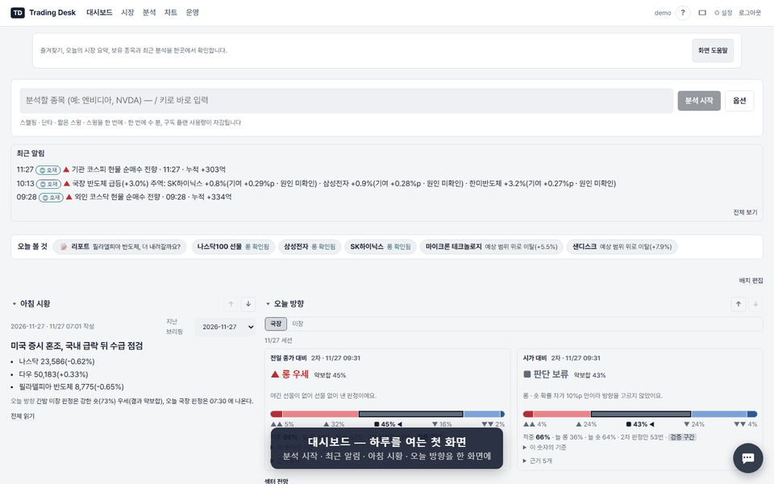
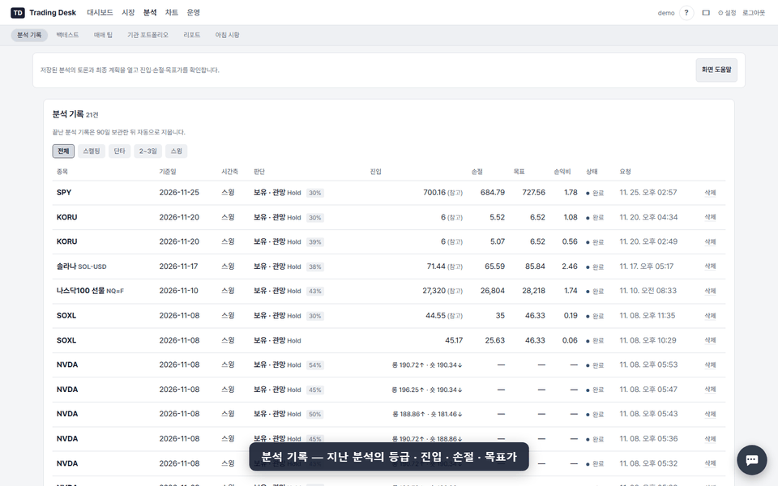
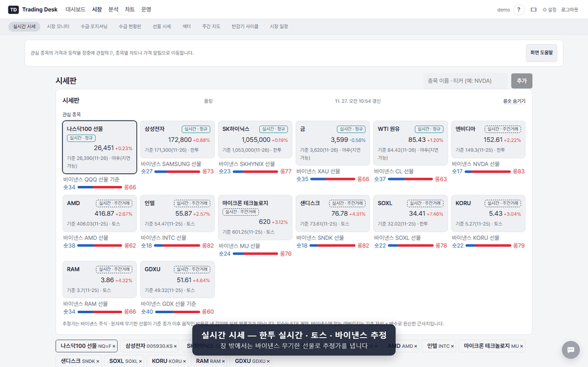
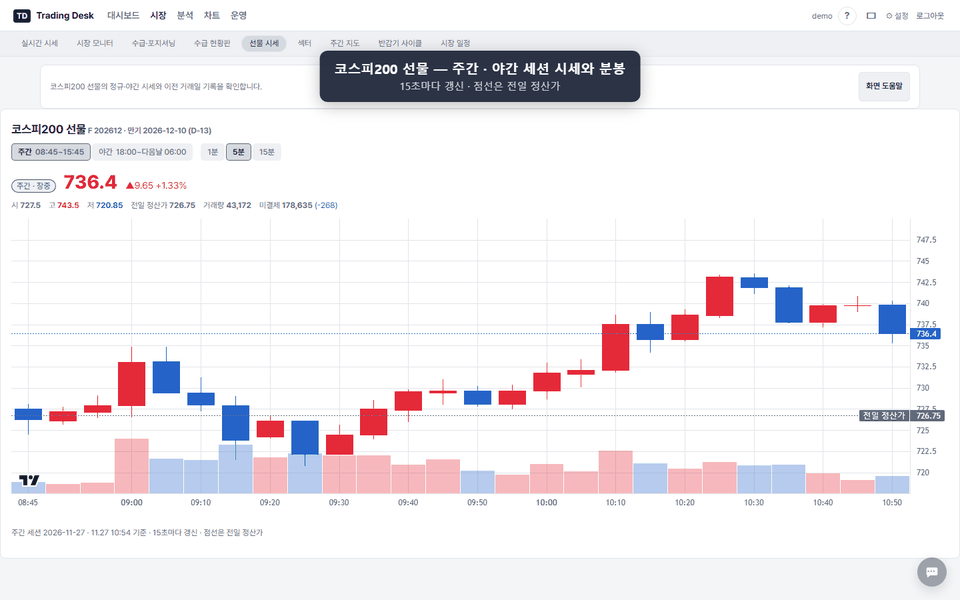
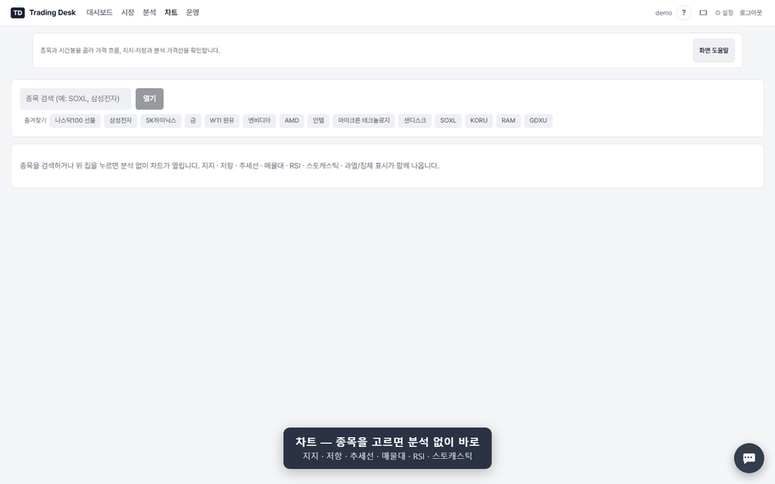
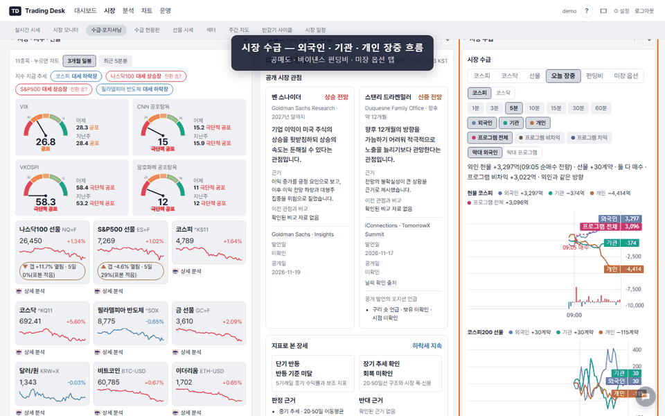
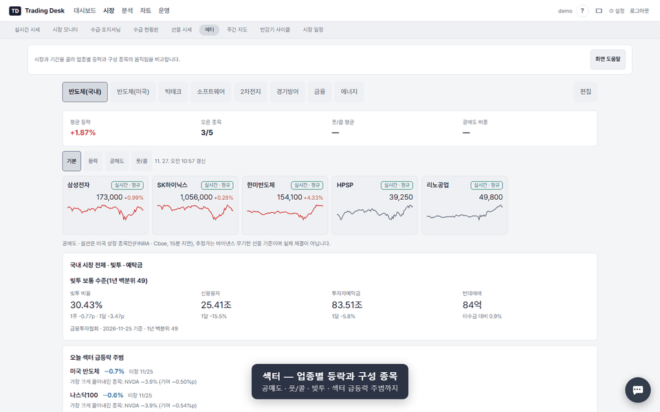
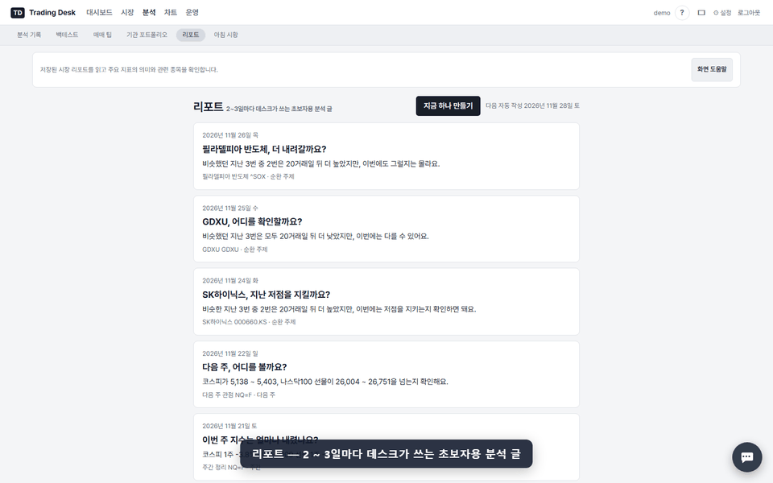
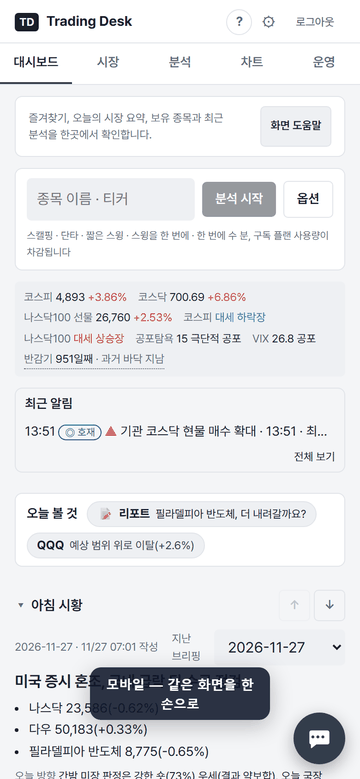

# 기능 소개 — 화면 흐름별 GIF

> 아래 GIF 는 **운영 서버(`trading.8llow8llowme.com`)를 Playwright 로 직접 조작해 녹화**했습니다(2026-11-27 장중).
> 화면 아래(차트 화면은 위) 자막이 지금 하는 일을, 주황 테두리 · 원이 설명하는 자리와 누르는 곳을 알려 줍니다.
>
> 계좌 정보는 싣지 않았습니다([docs/security.md](security.md) #775 — 계좌 데이터는 소유자만 봅니다). **소유자가 아닌 녹화용 계정**으로 찍어서
> 서버가 계좌 경로(보유 · 체결)를 막고, 계좌를 읽은 분석을 목록과 상세에서 빼고, 모의 계좌를 계좌 분석 없이 계산합니다.
> 녹화 브라우저도 같은 경로와 보유 종목 알림을 한 번 더 거릅니다(이중 방어).
> 녹화 · 변환 스크립트는 [docs/diagrams](diagrams/)에 있습니다(`record-features.mjs` → `frames-to-gif.py`).

## 목차

1. [대시보드](#1-대시보드)
2. [AI 분석 — 토론 · 계획 · 차트](#2-ai-분석--토론--계획--차트)
3. [실시간 시세 · 시장 모니터](#3-실시간-시세--시장-모니터)
4. [코스피200 선물](#4-코스피200-선물)
5. [차트](#5-차트)
6. [수급](#6-수급)
7. [섹터 · 주간 지도](#7-섹터--주간-지도)
8. [리포트 · 백테스트 · 모의 투자 · 방향 기록](#8-리포트--백테스트--모의-투자--방향-기록)
9. [모바일](#9-모바일)

## 1. 대시보드



- **분석 시작** — 종목 이름(한글 · 영문)이나 티커를 치면 토스 종목 목록에서 바로 찾습니다. 분석 한 번이 스캘핑 · 단타 · 짧은 스윙 · 스윙 네 기간을 함께 판단합니다.
- **최근 알림** — 국장 반도체 급등, 외인 현물 순매수 전환, 나스닥 선물 이상 징후 같은 장중 신호. 같은 알림이 웹 푸시 · 텔레그램으로도 옵니다.
- **아침 시황 · 오늘 방향** — 매일 아침 데스크가 시장을 정리하고, 국장 · 미장의 롱 / 숏 확률을 근거와 함께 냅니다. 판정은 장 뒤에 채점해 [방향 기록](#8-리포트--백테스트--모의-투자--방향-기록)에 쌓습니다.
- **카드 배치** — 시장 · 지수 · 선물, 주간 지도, 거시 · 정책 브리핑, 섹터 이슈, 즐겨찾기 시세, 시장 수급, 국내 공매도, 적중률, 빚투 · 예탁금… 카드는 접거나 순서를 바꿀 수 있고 화면에 들어올 때 읽습니다.
- **AI 채팅** — 오른쪽 아래 버튼. 데스크가 가진 자료(시세 · 분석 기록 · 수급)를 도구로 불러 답합니다.

## 2. AI 분석 — 토론 · 계획 · 차트



- **분석 기록** — 지난 분석의 등급 · 진입 · 손절 · 목표가 · 손익비 · 상태를 기간별로 봅니다.
- **요약** — "네 기간 한눈에": 기간마다 판단과 롱 · 숏 조건(진입 구간 · 손절 · 목표 1 · 2와 R)을 나란히 둡니다. 모델이 비운 가격은 ATR 로 채우고 출처를 표시합니다.
- **토론** — [TradingAgents](https://github.com/TauricResearch/TradingAgents) 의 애널리스트(시장 · 심리 · 뉴스 · 재무) → 강세 / 약세 토론 → 트레이더 → 리스크 토론 → PM 발언이 채팅처럼 쌓입니다.
  - 라이브러리의 상태 diff 로 "누가 무엇을 말했나"를 만들어(`events.StateDiffer`) DB 에 쓰고, SSE 는 DB 에서 재생합니다. 새로고침 · 재접속해도 대화가 남습니다.
  - 이 녹화의 SPY 분석은 15분 6초 걸렸습니다(ChatGPT 구독 플랜).
- **차트** — 진입 · 손절 · 목표선과 지지 · 저항 · 추세선을 봉 위에 그립니다.
- **근거 · 쉽게 보기** — 결론을 만든 지지 · 저항과 지표, 같은 결론을 초보자 말로 다시 쓴 해설.

## 3. 실시간 시세 · 시장 모니터



- **실시간 시세** — 국장은 한투(KIS) 실시간, 미장은 토스 · 한투, 장 밖에서는 바이낸스 무기한 선물로 낸 추정가를 씁니다. 칸마다 원천과 "실시간 · 정규 / 주간거래" 상태가 붙습니다.
- 종목 옆에 바이낸스 선물의 롱 · 숏 비율을 둡니다.
- 화면이 읽는 종목만 collector 가 모아 Redis 공유 캐시로 나눕니다(수요 기반 수집). 화면을 닫으면 그 종목 수집도 멈춥니다.
- **시장 모니터** — 관심군의 공통 기준일 성과 비교와 지역별 표, 일봉 차트로 바로 갑니다.

## 4. 코스피200 선물



- 주간(08:45 ~ 15:45) · 야간(18:00 ~ 다음 날 06:00) 세션의 시세와 1 · 5 · 15분 봉. 15초마다 갱신하고 점선은 전일 정산가입니다.
- 끝난 세션의 봉은 다음 같은 세션이 열릴 때까지 남겨 둡니다(#1020).

## 5. 차트



- 즐겨찾기 칩이나 검색으로 분석 없이 바로 엽니다. 분 · 시간 · 일 · 주봉.
- 지지 · 저항 · 추세선 · 매물대 · 가치영역, RSI · 스토캐스틱 · 과열 / 침체와 "지금 이 차트 읽기"(다음 확인 · 무효 조건).

## 6. 수급



- **시장 수급** — 코스피 · 코스닥 · 선물의 외국인 · 기관 · 개인 장중 흐름과 프로그램 매매, 공매도 · 바이낸스 펀딩비 · 미장 옵션 탭.
- **국장 수급 현황판** — KRX 확정 거래일 기준 시장 외국인 순매수와 관심 종목의 외국인 참여율 · 매수 우위 · 지분 22거래일.

## 7. 섹터 · 주간 지도



- **섹터** — 업종(반도체 국내 / 미국, 빅테크, 2차전지 …)별 평균 등락 · 오른 종목 · 풋 / 콜 · 공매도 비중과 구성 종목 스파크라인, 빚투 · 예탁금, 오늘 섹터 급등락 주범.
- **주간 지도** — 지수 · 섹터 ETF 의 주봉 위치(긴 하락 흐름 · 바닥 확인 …)와 다음 주에 볼 자리.

## 8. 리포트 · 백테스트 · 모의 투자 · 방향 기록



- **리포트** — 2 ~ 3일마다 데스크가 쓰는 초보자용 글. 차트와 "지금 볼 자리"가 함께 들어갑니다.
- **백테스트** — 계획 규칙을 몇 년 치 봉에 돌린 체결률 · 기대 R(학습 / 검증 구간). 저장소에 커밋한 스냅샷을 보여 주고, 규칙 코드가 바뀌면 "오래된 스냅샷"을 띄웁니다.
- **모의 투자** — 지난 분석의 진입 · 손절 · 목표대로 1,000만 원 가상 계좌에서 샀다면. 실제 주문은 없습니다. 소유자가 아닌 계정은 계좌를 읽지 않은 분석만으로 계산한 모의 계좌를 봅니다(이 녹화).
- **오늘 방향 기록** — 매일의 롱 / 숏 판정과 적중률, 단계별 · 확률 구간별 실제 결과.

## 9. 모바일



- 같은 화면을 한 손으로 봅니다. 메뉴는 위 탭, 분석 화면의 요약 · 차트 · 토론 · 근거는 아래 탭으로 옮깁니다.

## 다시 녹화하기

```bash
cd docs/diagrams
npm install && npx playwright install chromium
npm run record -- dashboard analysis   # 장면을 빼면 전부. 계정은 미리 설정한 DESK_DEMO_USER · DESK_DEMO_PASS 환경 변수
npm run gif                            # Pillow 필요
```

- 녹화 계정은 **소유자가 아닌 계정**(`python -m desk.cli create-user`)이어야 합니다. 로그인한 계정이 계좌를 읽을 수 있으면(소유자) 녹화기가 시작하지 않습니다.
- 계정 값은 미리 설정한 환경 변수로만 읽습니다(명령줄에 비밀번호를 치면 셸 이력에 남습니다). 프레임(`frames/`)은 커밋하지 않습니다.
- 녹화한 GIF 는 커밋 전에 프레임을 훑어 계좌 값 · 개인 정보가 없는지 봅니다.
